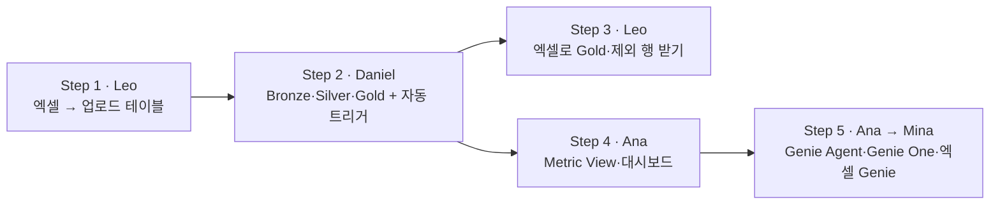

# 시나리오와 페르소나

이 페이지에서는 실습의 배경인 가상 회사와 등장인물, 실습 흐름을 설명합니다.

## 회사 소개

**Wanderbricks**는 전 세계 여행자와 숙소 호스트를 연결하는 휴가용 숙소 예약 플랫폼입니다.

- 고객은 165개국 약 12만 명이고, 국가마다 **지역 운영 매니저**가 있습니다.
- 예약 시스템을 옮기는 중이라, **최근 2개월 예약은 지역 운영 매니저가 엑셀로 정리해 보내고 있습니다.**
- 데이터팀은 매달 이 엑셀을 메일로 받아 손으로 합칩니다.
- 예약은 `pending` → `confirmed` → `completed`로 진행되고, 도중에 `cancelled`될 수 있습니다.

!!! info "데이터 출처"
    예약, 고객, 리뷰 데이터는 Databricks 샘플 데이터 `samples.wanderbricks`입니다. 2025년 6월과 7월 예약은 실습을 위해 엑셀 파일로 만들어 두었고, 엑셀을 올린 결과가 원본과 같은지 마지막에 확인합니다.

## 문제 장면

> *"6월 매출이 왜 지역 매니저 보고서랑 대시보드가 다르죠?"*

지역 운영 매니저 Leo가 엑셀로 보낸 6월 합계는 데이터팀 대시보드 매출보다 훨씬 큽니다. 엑셀의 모든 행을 더하면 **5,373,016.05**인데, 대시보드의 완료 매출은 **561,065.36**입니다. Leo의 엑셀에는 **취소된 예약** 금액이 들어 있었고, 몇 행은 **두 번 붙여 넣어져** 있었습니다. 게다가 금액 열이 `#,##0.00` 서식이라 업로드하면 `1,234.50`처럼 **쉼표가 붙은 글자**로 저장되어, 그대로는 숫자로 계산할 수 없습니다.

이 실습은 이 문제를 풀어 갑니다.

| 원인 | 해결하는 Step |
|---|---|
| 엑셀을 메일로 받아 손으로 합친다 | Step 1, 2: 엑셀 Add-in으로 올리고 자동으로 정제합니다 |
| 엑셀 값이 지저분하다 (쉼표 서식, 공백, 중복, 잘못된 상태·날짜) | Step 2: Silver에서 고치고, 고칠 수 없는 행은 사유와 함께 제외합니다 |
| "매출"을 사람마다 다르게 계산한다 (취소 포함 여부) | Step 4: Metric View에서 "매출" 정의를 한 번만 씁니다 |
| 현업은 숫자를 보려면 데이터팀에 요청해야 한다 | Step 3, 5: 엑셀로 Gold를 가져오고, Genie에 직접 묻습니다 |

## 페르소나

| 페르소나 | 역할 | 한 줄 | 담당 |
|---|---|---|---|
| 📗 **Leo** | 지역 운영 매니저 (현업) | "엑셀은 계속 쓰고 싶어요. 올리면 알아서 반영됐으면 좋겠어요." | Step 1, 3 |
| 🛠️ **Daniel** | Data Engineer | "메일로 온 엑셀을 합치는 데 매달 사흘을 써요." | Step 2 |
| 📊 **Ana** | Data Analyst | "매출 정의가 사람마다 달라서 숫자를 맞추느라 회의가 길어져요." | Step 4, 5.1 |
| 📣 **Mina** | Marketing Executive | "회의 전에 숫자를 직접 물어보고 싶어요." | Step 5.2 |

## 실습 흐름

## 마지막 장면

Mina가 Genie One에 "7월 국가별 매출"을 묻습니다. Leo는 엑셀 안의 Genie에서 같은 질문을 합니다. 두 사람 모두 Metric View의 정의로 같은 숫자를 받고, 그 숫자는 Leo가 아침에 올린 엑셀에서 자동으로 만들어진 것입니다.
