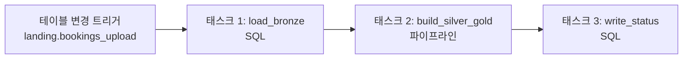

# 2) 자동 파이프라인 만들기

## 실습 개요 📋

Daniel은 매달 메일로 온 엑셀을 손으로 합치느라 사흘을 씁니다. 이 Step에서는 엑셀 업로드 테이블이 바뀔 때마다 **Job**이 실행되어 Bronze, Silver, Gold까지 자동으로 처리되도록 만듭니다.

## 이번 Step의 역할

{ width="96" }

**🛠️ Daniel - Data Engineer**

여러분은 데이터 엔지니어 Daniel입니다. 엑셀 업로드를 받아 Bronze에 원본을 쌓고, Silver에서 정제하고, 고칠 수 없는 행을 제외 테이블로 보냅니다. 마지막으로 업로드 테이블 변경 트리거로 전체를 자동화합니다.

## 실습 구조

이 Step은 Job 하나와 파이프라인 하나로 구성됩니다. Job은 세 태스크를 순서대로 실행합니다.

| 페이지 | 내용 |
|---|---|
| [2.1) Bronze: 시스템 데이터와 엑셀 업로드 이력](2-1-bronze.md) | 업로드 이력 테이블을 만들고 6월·7월 버전을 적재합니다 |
| [2.2) Silver·Gold: 정제, 제외 행, 고객 360](2-2-silver-gold.md) | 파이프라인으로 정제, 제외 행, Gold 테이블을 만듭니다 |
| [2.3) Job과 테이블 변경 트리거](2-3-job-trigger.md) | 세 태스크를 묶고, 한 번 실행한 뒤 업로드 테이블 변경 트리거를 답니다 |
| [2.4) 7월 엑셀로 자동 반영 확인](2-4-auto-refresh.md) | 트리거가 활성화된 뒤 7월 파일을 덮어쓰고, 자동 실행으로 Gold에 반영되는지 봅니다 |

## 이번 Step에서 사용하는 기능

| 기능 | 설명 |
|---|---|
| SQL 태스크 (Job) | 파일이나 쿼리를 Job의 한 단계로 실행합니다 |
| Lakeflow Spark Declarative Pipelines | 선언형 SQL로 Silver, Gold 테이블과 품질 규칙(Expectations)을 만듭니다 |
| 테이블 변경 트리거 (Table update) | 업로드 테이블이 바뀌면 Job을 시작합니다 |

## 학습 목표 🎯

- 업로드 이력을 문자열로 쌓고, 업로드한 사람과 시각을 함께 기록합니다.
- 정제 규칙과 제외 행 사유를 파이프라인으로 만듭니다.
- 테이블 변경 트리거로 자동 실행을 확인합니다.

!!! info "트리거는 약 1분 간격으로 확인합니다"
    테이블 변경을 바로 감지하지 않고 약 1분 주기로 확인합니다. 업로드 직후 처리가 끝나기까지 보통 1분 안팎 걸립니다. 처리 중에 또 올리면 중간 업로드가 건너뛰어질 수 있으니, 이전 실행이 끝난 뒤에 다시 올립니다.

## 예상 소요 시간 ⏱️

약 50분 (파이프라인 실행과 트리거 대기 포함)
