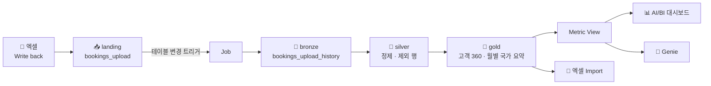

# Wanderbricks Excel 핸즈온 랩

**엑셀에서 올린 예약 데이터가 1분 안에 정제되어, 대시보드와 Genie가 같은 숫자를 보게 만드는 실습입니다.**

## 워크숍 개요

현업 담당자는 지금처럼 엑셀로 일하고, 데이터팀은 엑셀 업로드를 **Bronze, Silver, Gold**로 자동 정제합니다. 이 실습에서는 Wanderbricks 숙소 예약 데이터의 최근 2개월을 엑셀 파일로 만들어 업로드하고, 그 결과를 Metric View, AI/BI 대시보드, Genie에서 확인합니다.

- **소요 시간:** 약 3시간 10분 (Step별 시간의 합, 휴식 시간 별도)
- **대상:** 엑셀을 주로 쓰는 현업 담당자와, 이를 받아 처리하는 데이터 엔지니어·분석가
- **준비:** [사전 준비](00-introduction/prerequisites.md)에서 엑셀 Add-in 로그인까지 끝내 주세요

## 실습 여정

| Step | 실습 | 페르소나 | 핵심 기능 | 예상 소요 시간 |
|---|---|---|---|---|
| 소개 | 시나리오와 사전 준비 확인 | 강사 | - | 15분 |
| 1 | [엑셀에서 올리기](01-excel-upload/index.md) | Leo (지역 운영 매니저) | Excel Add-in Write back, 업로드 테이블 | 25분 |
| 2 | [자동 파이프라인 만들기](02-auto-pipeline/index.md) | Daniel (Data Engineer) | Job, Lakeflow 파이프라인, 테이블 변경 트리거 | 50분 |
| 3 | [엑셀로 결과 받기](03-excel-results/index.md) | Leo (지역 운영 매니저) | Excel Add-in 가져오기, 새로고침 | 20분 |
| 4 | [Metric View와 대시보드](04-metric-view-dashboard/index.md) | Ana (Data Analyst) | Metric View, AI/BI 대시보드 | 35분 |
| 5 | [Genie로 묻기](05-genie/index.md) | Ana → Mina (Marketing Executive) | Genie Agent, Genie One, Genie in Excel | 30분 |
| 마무리 | [정리와 리소스 삭제](99-wrap-up/index.md) | - | - | 15분 |

## 아키텍처

## 시작할 준비가 되셨나요? 🎯

- [ ] 엑셀 Add-in에 로그인할 수 있습니다
- [ ] SQL warehouse를 사용할 수 있습니다
- [ ] 카탈로그와 Job을 만들 권한이 있습니다 (없으면 관리자에게 공용 스키마를 받습니다)
- [ ] 실습 엑셀 파일을 내려받았습니다
